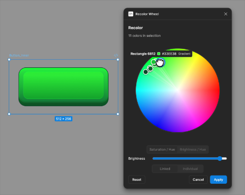
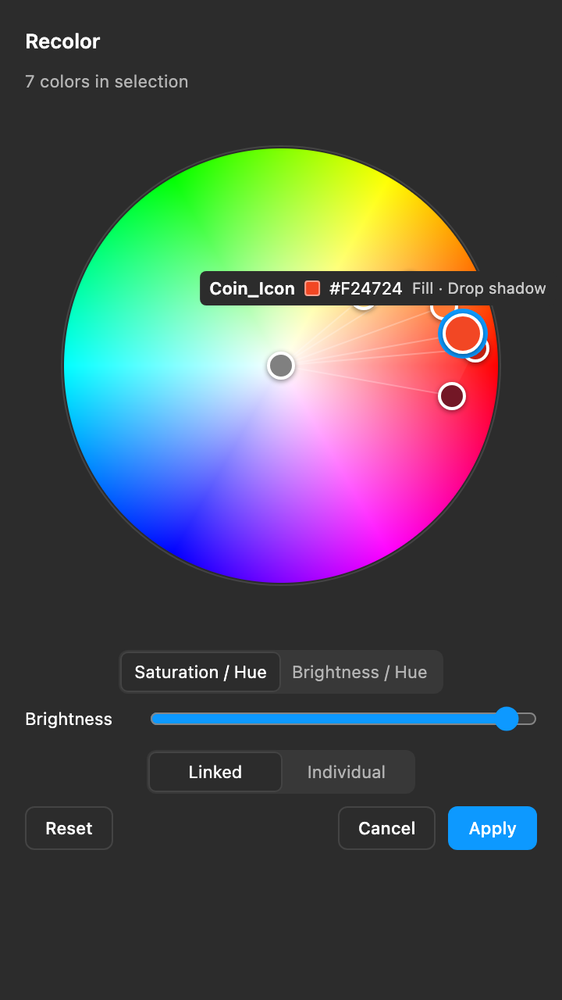
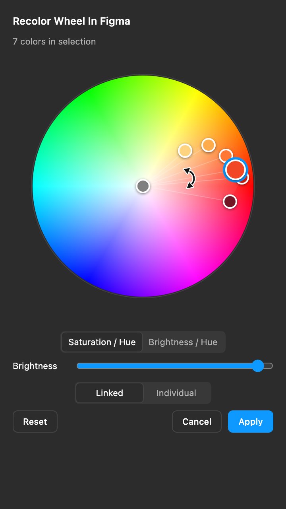
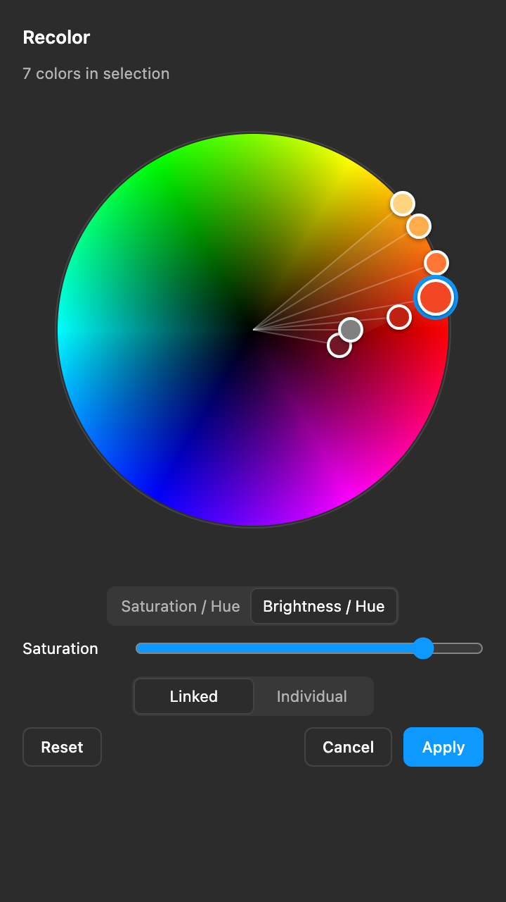
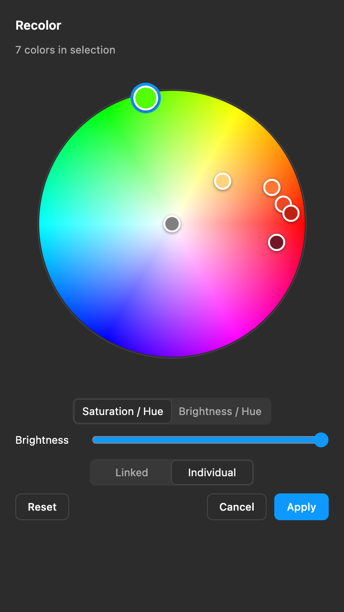

<div align="center">

<h1>Recolor Wheel In Figma</h1>

<hr>

<p><strong>Colour editing; a Figma plugin inspired by Illustrator's <em>Recolor Artwork</em> wheel, written in plain TypeScript.</strong><br>
Fills, strokes, gradient stops, shadows and masks of a whole selection on one hue wheel,<br>
recoloured live as you drag. No framework, no colour library, no network. Open source, offline, and yours.</p>

<p>


</p>



</div>

Select some vectors, open the plugin, and every colour in the selection shows up as a dot on the wheel. Drag the dots around and the canvas recolours live. That's the whole idea.

Two modes:

- **Linked** (default): all colours move together, so the palette keeps its relationships. Drag any dot, or grab the fan in the middle, to rotate the whole set at once. The big dot is the base colour: only it can be pulled towards or away from the centre, and the others follow.
- **Individual**: only the dot you're dragging moves.

## Features

Every screenshot below is the real plugin UI, rendered headless from the same build you install (`node scripts/screenshots.mjs`).

<table>
<tr>
<td width="50%" valign="top">



<p><em>Hover shows the layer, the hex, and whether the colour is a fill, stroke, gradient stop or shadow.</em></p>

### Know what you're touching

A selection with thirteen colours is thirteen anonymous dots. Hover one and it tells you which layer it came from (<code>+N</code> when several share it), the current hex, and what it is: <strong>Fill</strong>, <strong>Stroke</strong>, <strong>Gradient</strong>, <strong>Drop shadow</strong> or <strong>Inner shadow</strong>. Overlapping dots open a small picker so you can pick the right one instead of guessing.

</td>
<td width="50%" valign="top">



<p><em>Linked mode: the fan rotates the whole palette, the big base dot pulls it in and out.</em></p>

### Move the palette, keep the palette

Linked mode keeps the relationships between colours. Drag any dot or the fan in the middle to rotate every colour by the same angle. The enlarged <strong>base</strong> dot is the one you can also pull towards or away from the centre; every other dot only rotates, so a palette never falls apart by accident. Click a dot to make it the base.

</td>
</tr>
<tr>
<td width="50%" valign="top">



<p><em>Brightness / Hue wheel with the Saturation slider.</em></p>

### Two wheels, one slider

<strong>Saturation / Hue</strong> puts saturation on the radius and gives you a Brightness slider. <strong>Brightness / Hue</strong> puts brightness on the radius (black in the centre) and gives you a Saturation slider. Either way the slider edits the base colour, and in Linked mode every colour moves with it.

</td>
<td width="50%" valign="top">



<p><em>Individual mode: one dot moves, the rest of the palette stays put.</em></p>

### Linked or Individual

<strong>Linked</strong> is for recolouring a whole illustration: the dots move as one palette and the fan handle rotates everything together. <strong>Individual</strong> is for the one colour that is wrong: drag a single dot anywhere on the wheel and nothing else changes. Switch between them at any time; the canvas keeps updating live, and Reset puts the original colours back either way.

</td>
</tr>
</table>

## Getting it running

```sh
npm install
npm run build
```

Then in Figma: **Plugins → Development → Import plugin from manifest…** and pick `manifest.json` from this folder. Select a few vector layers, run *Recolor Wheel In Figma*, drag some dots.

`dist/` is gitignored, so you need to build before Figma can load it.

Other scripts:

| Script | What it does |
| --- | --- |
| `npm run watch` | rebuild on every change |
| `npm test` | unit tests (vitest) |
| `npm run typecheck` | `tsc --noEmit` |

### Poking at the UI without Figma

The UI is plain HTML and only talks to the plugin thread through `postMessage`, so you can serve `dist/` with any static server (there's a `ui-preview` config in `.claude/launch.json` that uses Python's `http.server` on port 4173), open `ui.html`, and dispatch a fake `session` message to it. Useful for CSS tweaks; not a substitute for testing in Figma.

## Using it

- **Drag a dot** to change its hue (angle) and its distance from the centre (saturation by default, brightness when the wheel is switched). In Linked mode the big dot is the base colour, like Illustrator: dragging it moves every colour, dragging any other dot only rotates the set. Click a dot to make it the base.
- **Fan handle** (Linked mode only): the translucent wedge between the centre and the dots is a group handle. Drag it to rotate every unlocked colour together.
- **Wheel axis and slider**: *Saturation / Hue* (default) puts saturation on the radius and gives you a Brightness slider; *Brightness / Hue* puts brightness on the radius (black centre) and gives you a Saturation slider. The slider edits the base colour; in Linked mode every colour shifts by the same amount.
- **Keyboard**: focus a dot and use ←/→ for hue (1°), ↑/↓ for the radius (0.01). Hold Shift for 10× steps.
- **Hover** a dot to see the layer that uses it (plus `+N` when more layers share the colour), its current hex, and where the colour lives: fill, stroke, gradient, drop shadow or inner shadow. Dots that overlap open a little picker so you can choose which one you mean.
- **Grey, black and white are editable.** Linked changes tint neutral colors using the active chromatic color (or the first chromatic color available). Gray/white retain brightness; black takes the reference brightness so its new color is visible. An entirely neutral selection uses full saturation/brightness as a fallback. Individual mode edits only the chosen dot; overlapping center dots have a picker.
- **Reset** puts the starting colours back and keeps the panel open.
- **Cancel** puts the starting colours back and closes the panel.
- **Apply** keeps what you see and closes the panel.

Heads up: closing the window with the native ✕ does *not* restore anything, so the last preview may stay on the canvas. Figma's Undo gets you out of that.

You can open the plugin first and select afterwards: until you change a colour, the wheel follows whatever you select. Once you have edited something the session stays pinned to those layers, and a note tells you so; press Reset to drop the edits and switch to the new selection.

## What gets recoloured

Yes:

- Solid fills and strokes.
- Gradient stops. Positions, alpha, gradient geometry, paint opacity and layer opacity are left alone; only the RGB moves.
- Inner and drop shadow colors. Alpha, blend mode, offset, blur radius, spread, and other effect settings stay unchanged. Matching fill and shadow colors share one wheel dot.
- Alpha and vector mask colors. Mask type, geometry, and alpha stay unchanged, preserving clipping.

No (left untouched, but counted in the status line):

- Text.
- Image, video and pattern paints.
- Hidden or locked layers, including their children.
- Luminance masks, whose RGB values control clipping.
- Paints bound to a paint style or a variable. If one paint in a list is bound, the whole list is skipped.
- Effects bound to an effect style or a variable. If one effect in a list is bound, the whole list is skipped.

Hidden paints/effects and effects without editable colors (such as blurs) remain untouched and are not included in the skipped count.

## How it's built

```
manifest.json         Figma manifest (dynamic-page, no network)
scripts/build.mjs     esbuild: src/main.ts → dist/main.js, src/ui.* → dist/ui.html
src/types.ts          message protocol + data model shared by both sides
src/colors.ts         pure maths: RGB/HSV, wheel coords, drag deltas (no DOM, no figma.*)
src/colors.test.ts    vitest
src/shadows.test.ts   shadow scan and plugin lifecycle regression tests
src/scan.ts           walks the selection, collects colours and paint targets
src/main.ts           plugin thread: snapshot, preview/apply/reset/cancel
src/ui.ts/.html/.css  the wheel, the dots, axis toggle + slider, pointer + keyboard handling
```

A few things worth knowing if you dig in:

- Colours are identified by their exact source RGB floats, not a rounded hex. The same RGB with different alpha is one dot that drives several paints.
- Every preview is computed from the snapshot taken at open time plus the current mapping. The mutated nodes are never re-read.
- Previews carry a session id and a revision number; the plugin thread drops stale ones and keeps at most one pending. Reset and Cancel bump the revision floor first so a late preview can't overwrite the restore.
- Wheel convention: hue 0 at 3 o'clock, going counter-clockwise; centre is S=0, rim is S=1 (or V on the Brightness / Hue wheel).

## Status

v0.1.1. Works in the browser preview and in tests; still being checked inside Figma itself. Open questions: whether an applied session ends up as one Undo step, whether variable-bound paints are detected reliably, what exactly happens on native window close, and how it performs at ~200 nodes.

Bug reports and ideas welcome. It's a small codebase, so PRs are easy to review.

## License

MIT. See [LICENSE](LICENSE).

Adobe and Illustrator are trademarks of Adobe Inc. This is an independent project inspired by Illustrator's Recolor Artwork feature; it is not affiliated with or endorsed by Adobe or Figma.
